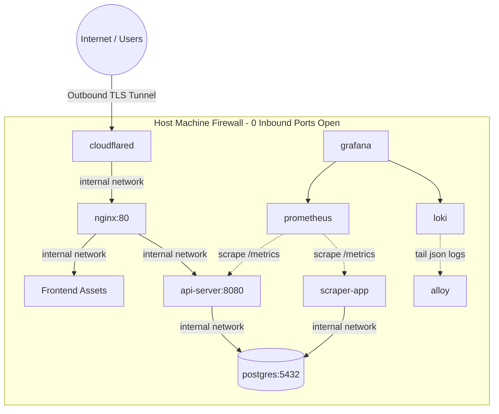

# BiH Power Alerts


Vozdra svima koji čitaju! :D Pisati ću na engleskom da bude nekako lakše!

Hi all! So, this is a all-in-one repo that aims to provide you with a simple to roll out Bosnian electricity outage scraper across all electrical providers in Bosnia and Herzegovina.

I also map via OpenStreetMap Nominatim and provide Web Push and Telegram notifications to you 2 hours before scheduled interruptions.

I also have a PWA app included, which you can you can install via your standard browser tooling (open menu and go add to home screen or install PWA, look it up :D)

I also aimed to build it with all proper tooling currently used in the industry such as Prometheus, Loki, Grafana, DB is PostgreSQL, but not a must, can easily be swapped out for something else, as I use Docker Containers.

There's also to-VPS terraform included (will expand) and Ansible. A lot of cool things in it, take a look!

Code is fully Python based. Linted with Github CI, Black, isort and flake8. :D Ofc can be deployed if you want to, too.

Web side is served via nginx, but of course can be changed. :D

Btw speaking of CI, I also do yamlint, hadolint (Dockerfile and all yaml files linting and checking it's compatible and Docker well structured).

And most importantly pip-audit - I run pip audit to check old and also I have local tests I run via `pytest tests/` and in the end I verify the build `docker build -t outage-scraper:test .`.

Cool right :D

---

## Why even build it though?

Well, I built this because checking the provider's website for scheduled maintenance is usually tedious and a really manual process. Perhaps not for all providers as we have 7, can you believe it, but from what I've seen the data is mostly buried in posts and unstructured.

So I wrote a small cron-based Python script for my local EPBiH provider after I lost data from not saving far too many times (should get an UPS lol) and it evolved into this project.

So I wanted to help out the community, build something useful for all of us but also to try and learn something new.

I decided then to use this project as a learning, uhh "platform" to try to build something that would be accepted even in professional work.

I did use some aid of LLM, but I went through most of the code manually and wrote the original scripts myself, though they are now expanded into Classes and differ compared to my original simple BeautifulSoup parser. 

I did originally want to juse use Sqlite3 and throw a few cron scripts on a VPS, but I figured let me actually build something that people would point at and say, yes, that's good! And to learn. I wish to become a SRE :D 

## Live Demo & Screenshots

**Live Application:** [struja.ituco.dev](https://struja.ituco.dev)

#### • Front page and leaflet with heatmaps (works better, less lag - install PWA here too):
 - 
  
#### • Grafana showing scraper latencies, active PostgreSQL connections, and the Loki log stream:


#### • Telegram bot:
-  - 

---

## Cool mermaid layout



---

## Security funzies I did

- **NixOS fans about to go crazy:** Containers run with `read_only: true` and root filesystems bounded with `tmpfs` mounts - preventing malicious modification and any potential malware persistence (yay)
- **Root = bad:** Processes run under an unprivileged system user (`scraperuser`, UID 10001) and database port `5432` has zero host bindings
- **Cloudflared:** Inbound traffic runs fully through Cloudflare Tunnels via and my firewall exposes zero public listening ports (checkmate nmappers)
- **"Self-healing" (fr) scraper:** I do tests w/ regex when I parse and I have regression tests which panics on provider data shifts in layout or whatever.
- **Fancy DevOps stuff:** JSON logging (`python-json-logger`), Prometheus metrics endpoints, aggregation via Loki and all nicely shown in Grafana
- **Cron but not cron:** Two hrs before outage you get another notification (and one upon first time its seen)

---

## Usage Guide

Look basically, its made to be simple A F. You sub or you just run command. And it just works (I hope) lol

1. **The Web App (PWA):** You visit the site, click on the map (which reverse-geocodes street info via nominatim) or you could (preferred actually) enter it manually and then you click "Subscribe".

And you're.. Subscribed! Yay!
 
Also, for the PWA and the `manifest.json` and js service worker, bonus if you are on mobile alongside push notifs you can also (and pls do) install the site directly to the home screen as a native-feeling app. Sweet eh?

2. **Telegram Bot:** It actually works even better. You can message the bot `/subscribe Ulica (street), Broj (Number), Grad (City)`. The backend parses the input, associates your Telly Chat ID with the database and routes future alerts directly to you.
    
3. **What after:** Once subscribed, you do nothing. It just works.

---

## How to roll out (like autobots fr) & Operation guide

If you want to run this stack yourself the rollout is fully automated :D

**If you want to provision infra:**
The base server infrastructure I hoped to manage via Terraform, but GCP and AWS very expensive :(

So I set it up (or need to) to basically target only a standard Linux VPS. And then Ansible and Docker Compos take over an you just chillax.

**Configuration management:**
So, Ansible handles the configuration, it installs Docker, sets up the user groups, pulls the repo, injects the `.env` secrets and starts up Docker Compose. 

**Monitoring:**

If we run into an error:

1. Should be caught and logged as a structured JSON event,
2. Promtail/Alloy ships the log to Loki,
3. Prometheus detects the drop in the `outages_collected` metric,
4. Grafana fires an alert directly to the admin's Telegram so the regex can be patched before the next scheduled run (to-do btw)

---

## Getting Started

### Prerequisites
- Docker Engine 24.0+ & Docker Compose
- Cloudflare Tunnel Token
- VAPID Public/Private Keypair

### Deployment
1. **Clone the repository:**
   ```bash
   git clone [https://github.com/e75ti/power_outages_ba](https://github.com/e75ti/power_outages_ba)
   cd power_outages_ba
   ```

2. **Configure secrets:**
   ```bash
   cp .env.example .env
   chmod 600 .env
   ```
   (Add your VAPID keys, secure Postgres passwords, and Cloudflare tokens to your `.env`)

3. **Deploy the stack:**
   ```bash
   docker compose up -d --build
   ```

---

## Testing
Run unit and upstream change tests:
```bash
docker exec -it outage-api python -m pytest tests/ -v
```

There are pytests included in the CI workflow, and the Terraform/Ansible configurations are located in their respective directories should you want to provision remote infrastructure. The code is linted formatted with black, imports sorted nicely with isort and linted after with flake8. I opted to not use pylint, because .pylintrc would be very big and frankly, I'd love to shadow a senior first to learn proper lining architectural choices than to make up my own which might be wrong.

Good luck! Thanks for reading.
